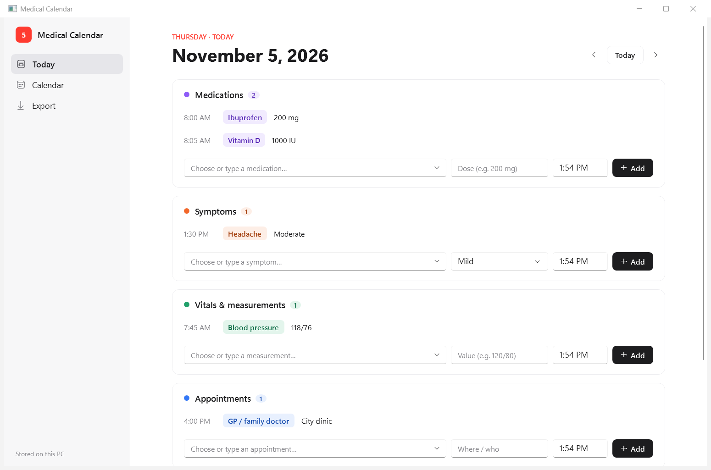
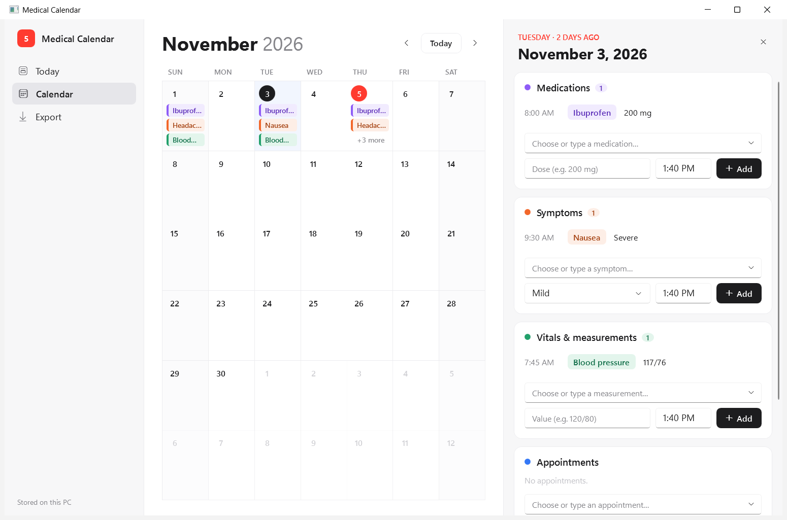
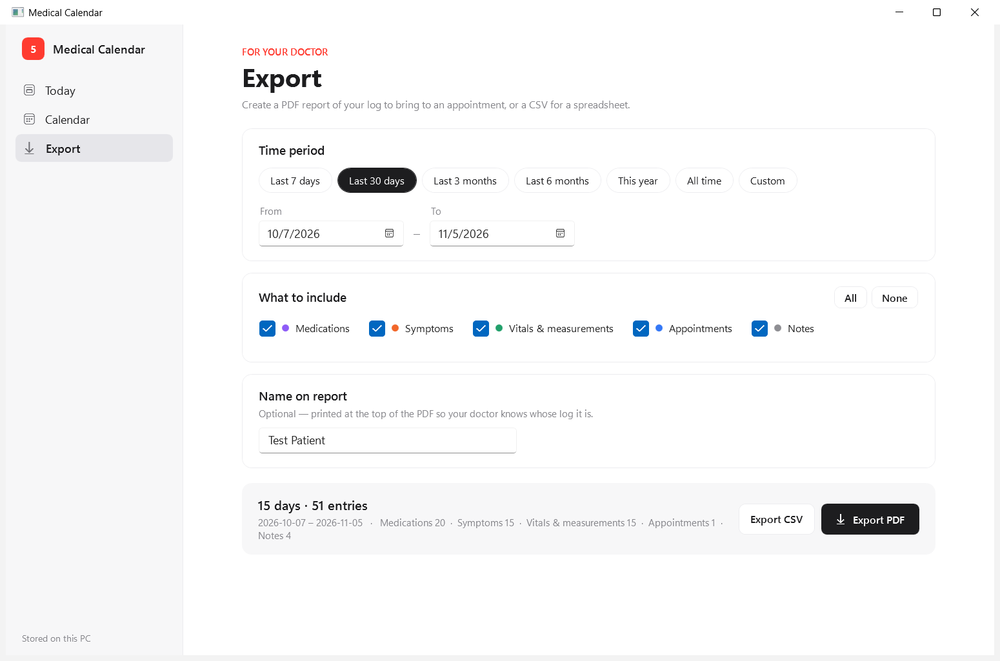

# Medical Calendar

A private, offline health log for Windows. Record medications, symptoms, vitals and appointments each day, review them on a calendar, and export a clean PDF report to bring to your doctor.

Native Windows app (C# / WPF on .NET 10). No account, no cloud, no internet connection — your data stays on your PC.



| Calendar with day panel | Export for your doctor |
|---|---|
|  |  |

[See a sample PDF report](docs/sample-report.pdf) (made from test data).

> **Not medical advice.** Medical Calendar is a personal record-keeping tool. It does not diagnose, recommend treatment, or check doses or drug interactions. Always follow your doctor's or pharmacist's instructions.

---

## Contents

- [Features](#features)
- [Install](#install)
- [Using the app](#using-the-app)
- [Your data](#your-data)
- [Troubleshooting](#troubleshooting)
- [Building from source](#building-from-source)
- [Project layout](#project-layout)
- [Developer notes](#developer-notes)
- [Releasing a new version](#releasing-a-new-version)
- [License](#license)

---

## Features

**Daily log (Today)**
- Four categories, each with a searchable, grouped list of common items:
  - **Medications** — pain & fever, allergy, digestion, cold & cough, respiratory, sleep, prescription, vitamins & supplements. Records dose and time.
  - **Symptoms** — general, pain, respiratory, digestive, mental & sleep, skin & eyes. Records severity (Mild / Moderate / Severe) and time.
  - **Vitals & measurements** — blood pressure, heart rate, temperature, SpO2, weight, blood glucose, sleep, water, steps and more. Records the value and time.
  - **Appointments** — doctor visits, tests and procedures. Records where/who and time.
- Free-text **Notes** for each day.
- Type to filter the list. Anything not in the list is saved to **My items** so it's there next time; remove it with the × in the list.
- Edit or delete any entry (hover it, or double-click it).
- Entries are kept in time order and saved automatically as you type.

**Calendar**
- Month view with colour-coded labels for each day's entries.
- Click a day to open an editable panel on the right without leaving the calendar.

**Export**
- Choose a period: last 7 days, 30 days, 3 months, 6 months, this year, all time, or custom dates.
- Choose what to include: any combination of medications, symptoms, vitals, appointments and notes.
- **PDF report (A4):** a summary per category (how often, worst severity, doses used, every vital reading), then a day-by-day log. Optional name at the top. Page numbers. Japanese text supported.
- **CSV** for Excel or other spreadsheets.

---

## Install

**Requirements:** Windows 10 (version 1809 or later) or Windows 11, 64-bit. Nothing else — .NET is included in the app.

1. Get `MedicalCalendar.exe`, either from the repository's **Releases** page or by [building it yourself](#building-from-source).
2. Put it anywhere you like, for example `C:\Users\<you>\Apps\MedicalCalendar\`.
3. Double-click it. To pin it, right-click → **Pin to Start** or **Show more options → Send to → Desktop (create shortcut)**.

There is no installer and nothing is written outside your user profile. To uninstall, delete the exe (and, if you want, your data folder — see [Your data](#your-data)).

### "Windows protected your PC"

The exe is not code-signed yet. If you **downloaded** it, Windows SmartScreen may show this warning the first time. To run it:

- Click **More info → Run anyway**, or
- Right-click the exe → **Properties** → tick **Unblock** → **OK**.

An exe you build yourself on your own PC never shows this warning.

---

## Using the app

### Today
1. Click the name box in a card and start typing (e.g. `ibu`) or press **↓** to browse the full list.
2. Pick an item with the mouse or **↑/↓** and **Enter**.
3. Fill in the dose / severity / value, check the time, and press **Enter** or **Add**.

Use **‹ Today ›** at the top to log a different day.

### Calendar
Click any day to open it in the side panel. Edits there save immediately and update the calendar. Click the same day again, the ×, or press **Esc** to close it.

### Export
1. Pick a time period and tick what to include. The summary at the bottom shows how many days and entries will be exported.
2. Optionally enter the name to print on the report.
3. Click **Export PDF** (or **Export CSV**) and choose where to save. Downloads is suggested by default.
4. Use **Open** or **Show in folder** to find the file.

### Keyboard shortcuts

| Where | Key | Action |
|---|---|---|
| Today | ← / → | Previous / next day |
| Today, Calendar | T | Jump to today |
| Calendar | PgUp / PgDn, mouse wheel | Previous / next month |
| Item name box | ↓ / ↑, Enter, Esc | Browse, pick, close the list |
| Any card | Enter | Add (or Save when editing) |
| Anywhere | Esc | Cancel editing / leave a text box / close the day panel |

---

## Your data

Everything is stored **only on this PC**, in your user profile:

```
%LOCALAPPDATA%\MedicalCalendar\
├── data.json          ← all your entries, notes and custom items
├── backups\           ← one copy of data.json per day, newest 30 kept
└── error.log          ← technical errors only (no health data)
```

Paste `%LOCALAPPDATA%\MedicalCalendar` into the File Explorer address bar to open it.

- **No network access.** The app never connects to the internet.
- **Safe saving.** Changes are saved within half a second, written to a temporary file first and then swapped in, so a crash or power cut can't leave a half-written file.
- **Automatic backups.** Each day the app is opened, a copy of the data file goes into `backups\`.
- **Damaged file protection.** If `data.json` ever can't be read, the app keeps it untouched (as `data.unreadable-<date>.json`), loads the newest good backup, and tells you what it did.
- **Not encrypted.** The file is plain JSON protected by your Windows account. Anyone who can sign in as you can read it. Use BitLocker / Device Encryption if your PC is shared or portable.

**Back up or move to a new PC:** close the app, copy the whole `MedicalCalendar` folder, and put it in `%LOCALAPPDATA%` on the other PC.

---

## Troubleshooting

| Problem | What to do |
|---|---|
| "Windows protected your PC" | See [above](#windows-protected-your-pc). |
| Export says Windows blocked saving | Windows Security's **Controlled folder access** blocks new apps from Documents/Desktop. Save to **Downloads**, or allow the app under *Windows Security → Virus & threat protection → Ransomware protection → Allow an app*. |
| Opening the app again does nothing | It's already running; the existing window is brought to the front. Only one copy runs at a time so two windows can't overwrite each other's saves. |
| Something went wrong / data looks missing | Look in `%LOCALAPPDATA%\MedicalCalendar\backups\` for earlier copies, and check `error.log`. To restore a backup: close the app, copy the backup over `data.json`, reopen. |

---

## Building from source

**Requirements**
- Windows 10/11 x64
- [.NET 10 SDK](https://dotnet.microsoft.com/download): `winget install Microsoft.DotNet.SDK.10`
- Optional: Visual Studio 2022/2026, or VS Code with the **C# Dev Kit** extension (open `MedicalCalendar.sln`)

| Task | Command |
|---|---|
| Run in development | `run.cmd` or `dotnet run --project src/MedicalCalendar` |
| Build the release exe | `publish.cmd` → `dist\MedicalCalendar.exe` |
| Run the tests | `dotnet test` |

The helper scripts are `.cmd` files so PowerShell's script execution policy can't block them. If `dotnet` isn't recognised right after installing the SDK, open a new terminal.

The release build is a single, **self-contained** x64 exe (about 215 MB, because it bundles the .NET runtime). It is precompiled (ReadyToRun) for fast startup, and deliberately **not** compressed or self-extracting, which avoids common antivirus false positives.

---

## Project layout

```
MedicalCalendar.sln
run.cmd / publish.cmd           Dev run and release build
docs/                           Screenshots and a sample report
tests/MedicalCalendar.Tests/    xUnit tests: data/backup/recovery, export, PDF, entry editing
src/MedicalCalendar/
├── App.xaml(.cs)               Theme, shared styles, single-instance + crash handling
├── MainWindow.xaml(.cs)        Shell: sidebar, Today page, Calendar page + day panel
├── SectionCard.xaml(.cs)       One category card (entries + add/edit row), wide or compact
├── SuggestBox.xaml(.cs)        Type-to-filter grouped item picker
├── ExportView.xaml(.cs)        Export page (period, categories, PDF/CSV)
├── Catalog.cs                  Categories, built-in item lists, colours
├── CategorySection.cs          View model for a category card (add/edit/remove, custom items)
├── Store.cs                    Data model, JSON load/save, backups, recovery
├── Report.cs                   Selects and summarises data for export
├── PdfReport.cs / PdfFonts.cs  PDF layout (MigraDoc) and font handling (incl. Japanese)
├── CsvReport.cs                CSV export
├── DayCell.cs, ViewModels.cs   Calendar cell model, MVVM helpers
├── AppPaths.cs                 Data/backup/log locations, error log
└── app.manifest                No admin prompt, per-monitor DPI, Windows 10/11
```

To add or change built-in items, edit the lists in [Catalog.cs](src/MedicalCalendar/Catalog.cs).

---

## Developer notes

- **Test data folder.** Set `MEDCAL_DATA_DIR` to any folder to run the app against separate data, so you never touch your real log. Exports then default to that folder too.
  ```cmd
  set MEDCAL_DATA_DIR=%TEMP%\medcal-test && run.cmd
  ```
- **PDF library is pinned.** `PDFsharp-MigraDoc` is pinned to **6.2.4**, the last MIT-licensed release. Version 6.5.0 and later are AGPL-3.0 and need a runtime license key. Don't upgrade without reviewing the licence.
- **Fonts in PDFs.** Latin text uses Segoe UI. If the report contains Japanese/Chinese/Korean text, Yu Gothic is used (falling back to Meiryo, then MS Gothic). Windows ships these as `.ttc` collections; `PdfFonts.cs` extracts the first face.
- **Windows 11 look.** Standard controls use WPF's built-in Fluent theme (`ThemeMode="Light"` in `App.xaml`). The API is marked experimental, so the warning `WPF0001` is suppressed in the project file.
- **File encoding.** Source files are UTF-8 and some contain non-ASCII characters (icons, dashes, quotes). Don't edit them with Windows PowerShell 5.1's `Get-Content`/`Set-Content` without `-Encoding UTF8`: it re-saves them as ANSI and garbles those characters.
- **Data format.** `data.json` has a `Version` field (currently `2`). Version 1 (`entries.json`, plain notes) is migrated automatically on first launch.

---

## Releasing a new version

1. Update `<Version>` in [MedicalCalendar.csproj](src/MedicalCalendar/MedicalCalendar.csproj) and `assemblyIdentity version` in [app.manifest](src/MedicalCalendar/app.manifest).
2. Add an entry to [CHANGELOG.md](CHANGELOG.md).
3. Run `publish.cmd` and check `dist\MedicalCalendar.exe` starts.
4. Commit, then tag: `git tag -a v1.2.3 -m "v1.2.3"` and `git push origin v1.2.3`.
5. On GitHub, create a release from the tag and attach `MedicalCalendar.exe` and its SHA-256 (`certutil -hashfile dist\MedicalCalendar.exe SHA256`).

---

## License

Copyright © 2026 Komei Okamoto. No open-source licence has been chosen yet, so all rights are reserved.

Third-party components are listed in [THIRD-PARTY-NOTICES.md](THIRD-PARTY-NOTICES.md).
